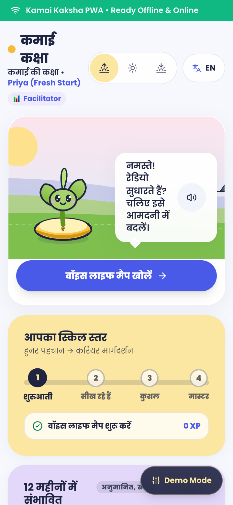
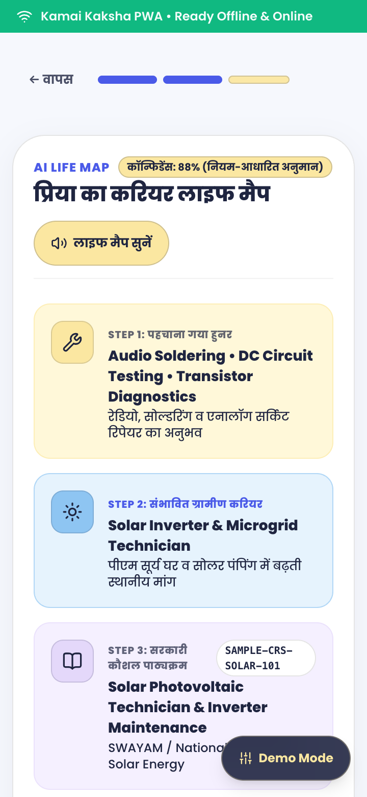
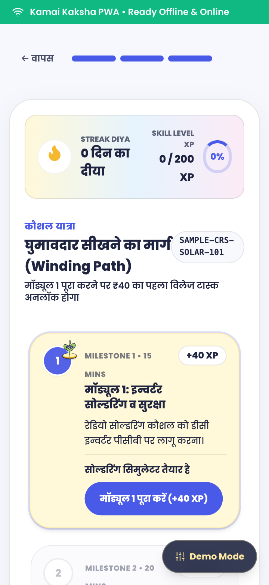
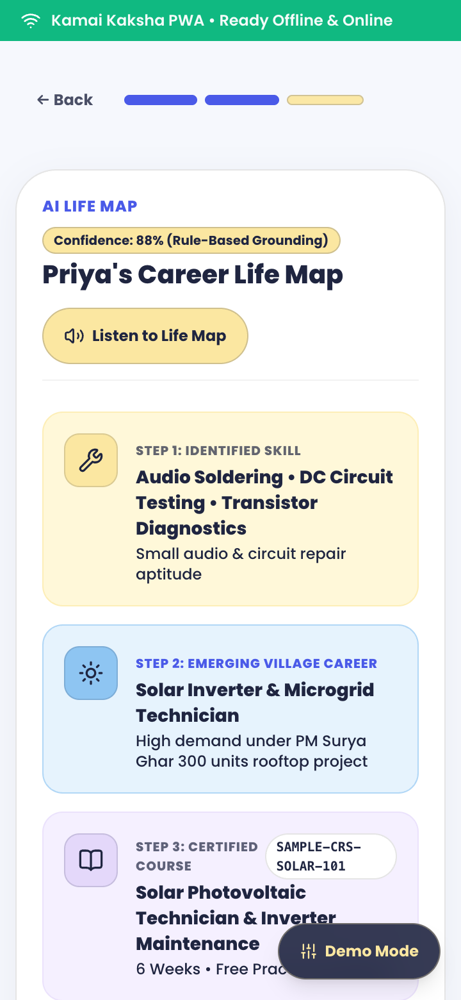
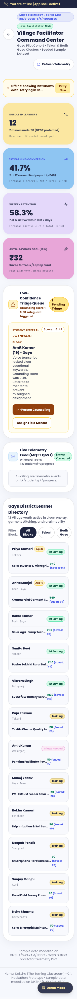
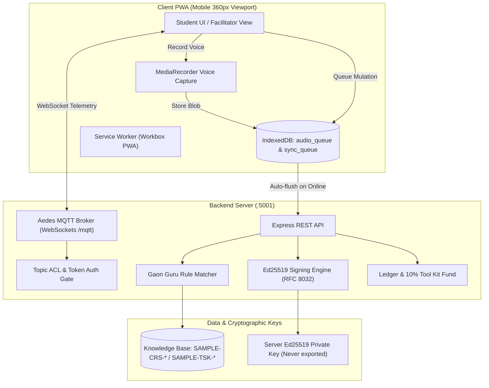

# Kamai Kaksha (कमाई की कक्षा) — The Earning Classroom

> **Turning village students' skills into income, savings, and verifiable credit history.**  
> *Developed for the Citi Hackathon Prototype Evaluation.*

<p align="center">
  
  
  
  
  
</p>

---

## What's Real vs. Simulated

To ensure transparency and integrity during evaluation, the table below delineates every functional subsystem in Kamai Kaksha:

| Component | Status | Implementation Details |
| :--- | :--- | :--- |
| **Offline Sync Queue** | **REAL** | Built with IndexedDB (`idb`). Queues events when offline, survives browser reload and server kills, and flushes automatically on network reconnect. |
| **IndexedDB Audio Storage** | **REAL** | `MediaRecorder` captures real audio chunks into a `Blob` in client IndexedDB (`audio_queue`). Audio is permanently deleted immediately following transcription. |
| **Ed25519 Cryptographic Proofs** | **REAL** | Generated using Node.js `crypto.sign(null, canonicalBytes, privateKey)` (RFC 8032 Ed25519). Public key is exposed via `/api/credentials/public-key`. |
| **Tamper Detection** | **REAL** | Uses RFC 8785 recursive deterministic canonical JSON stringification. Tampering with any field (e.g. grade, qualification, subject) invalidates verification (`verified: false`). |
| **MQTT Broker & ACLs** | **REAL** | Embedded Aedes MQTT broker running over WebSockets on port `5001/mqtt`. Per-student auth tokens, strict topic ACLs (`student/{id}/#`), student wildcard denied, facilitator allowed. |
| **Rate Limiter** | **REAL** | Task evidence submission throttled per student ID (5-second cooldown). Returns HTTP 429 with `Retry-After` header and cooldown timer in UI. |
| **Speech-to-Text (STT)** | **SIMULATED** | Rule-based semantic keyword extractor (`ai-service` mock). Web Speech API serves as online fast path. No audio retained. Labelled as demo transcript. |
| **UPI Micro-Payouts** | **SIMULATED** | Simulated VPA (`priya@okgramin`) and mock transaction references (`UPI-MOCK-******`). Zero real fiat currency moved. 10% auto-deducted to Tool Kit Fund. |
| **3-Peer Cross-Validation** | **SIMULATED** | Simulated peer review network (Rahul, Meera, Amit) modelled on Gaya vocational batchmates. |
| **Minor Guardian Consent** | **SIMULATED** | Interactive DPDP plain-language consent modal with guardian phone verification step for under-18 learners. Labelled as simulated in UI. |
| **Credit Score Projection** | **SIMULATED** | Illustrative 12-month earning and creditworthiness trajectory modelled on rural SHG micro-credit data. |
| **Gaon Guru Job Radar** | **SIMULATED** | Local village job opportunities modelled on PM Surya Ghar rooftop solar cluster hubs in Gaya District. |

---

## System Architecture



---

## Facilitator Metric Formulas

Facilitator metrics are dynamically calculated from seed records across Gaya district batches (`server/src/index.js` -> `/api/facilitator/metrics`). Values match the live facilitator dashboard:

1. **First-Earning Rate (41.7%)**:
   $$\text{First-Earning Rate} = \left(\frac{\text{Students with } \ge 1 \text{ Earning}}{\text{Total Students}}\right) \times 100 = \left(\frac{5}{12}\right) \times 100 = 41.7\%$$

2. **Weekly Retention Rate (58.3%)**:
   $$\text{Weekly Retention} = \left(\frac{\text{Students Active in Past 7 Days}}{\text{Total Students}}\right) \times 100 = \left(\frac{7}{12}\right) \times 100 = 58.3\%$$

3. **Village Tool Kit Fund Pool (₹32 pooled)**:
   $$\text{Total Fund} = \sum_{s \in \text{Students}} \text{Auto-Saved Amount}_s = ₹32$$
   *Tekari Block aggregate reserved for multimeter and soldering iron toolkits.*

4. **Triage Queue Count (1 learner)**:
   $$\text{Triage Count} = \sum \mathbf{1}_{\{\text{confidence} < 0.60 \lor \text{triage\_needed} = \text{true}\}} = 1 \text{ learner}$$

---

## Wow-Flow: 5 Interactive Steps

1. **Consent Gate**: DPDP plain-language consent with guardian verification for minor Priya (age 17).
2. **Voice Life Map**: Capture spoken skill in Hindi/Magahi -> Audio queued in IndexedDB -> Transcribed & purged -> Grounded curriculum displayed (`SAMPLE-CRS-SOLAR-101`).
3. **Interactive Winding Learning Path**: Day 0 Fresh Priya completes Module 1 (+40 XP) -> Unlocks village micro-task.
4. **Village Micro-Task & Wallet**: Submit multimeter ground check -> 3-peer cross-validation -> ₹40 reward credited (₹4 auto-saved to Tool Kit Fund, ₹36 spendable cash).
5. **Verifiable Credential**: Server signs Ed25519 vocational credential (`did:web:kamai-kaksha.example`) -> Live QR verify -> Export DigiLocker-aligned JSON.

---

## Quickstart & Run Instructions

### Prerequisites
- Node.js >= 18.0.0
- npm >= 9.0.0

### One-Command Startup
```bash
# Clone the repository
git clone <repo-url> kamai-kaksha
cd kamai-kaksha

# Install dependencies for all workspaces
npm install

# Start both Express server (:5001) and Vite PWA client (:5173)
npm start
```
The application opens at:
- **Client PWA**: `http://localhost:5173`
- **Backend API & Health**: `http://localhost:5001/api/health`
- **Facilitator Dashboard**: `http://localhost:5173/?view=facilitator`
- **About & Architecture**: `http://localhost:5173/?view=about`
- **Showcase Gallery**: `http://localhost:5173/?view=showcase`
- **Interactive Demo Frame**: `http://localhost:5173/?view=demo-frame`

### Docker Deployment (Untested)
> [!NOTE]
> Docker deployment (`docker-compose up`) configuration is provided via `docker-compose.yml`, `Dockerfile.server`, and `Dockerfile.client`, but marked **UNTESTED** in the current evaluation environment.

### Automated Test Suite
> [!NOTE]
> Tests are API-level integration tests runnable via `npm test` verifying sync queue, knowledge base IDs, Ed25519 signatures, tamper rejection, minor consent gates, and rate limits.
```bash
npm test
```

---

## Known Limitations & Design Rationale

1. **Dashboard Polling**: The facilitator dashboard currently uses resilient HTTP polling with exponential backoff and last-known data caching. Bi-directional MQTT subscription from the dashboard UI is on the roadmap.
2. **In-Memory Store & Ephemeral Keys**: Student wallets, task states, and ephemeral Ed25519 signing keys reside in server memory and reset on restart (credentials issued prior to restart become invalid after restart). Facilitator secret and student tokens are demo-only credentials.
3. **Minor Safeguards**: Priya is 17 years old. In accordance with adolescent labor guidelines (Child and Adolescent Labour Act), micro-tasks are restricted to non-hazardous daytime domestic clean energy checks with guardian consent. Labelled `"minor safeguards, pending legal review"`.
4. **Key Isolation**: The server's Ed25519 private key is strictly isolated server-side. The client receives only public keys and verification responses.
5. **Privacy & Audio Purge**: Raw audio captured during offline voice recording is permanently deleted immediately following transcription. No raw audio recordings are retained on device or server. The online fast path utilizes the browser's native Web Speech engine.
6. **Issuer Status**: The credential issuer DID is `did:web:kamai-kaksha.example`, explicitly labelled `"Demo issuer, not a government credential"`. All IDs are prefixed with `SAMPLE-`.

---

## Future Roadmap

- [ ] **Real STT Integration**: Connect Bhashini / Whisper APIs for robust low-resource Bihari dialects (Magahi, Maithili, Bhojpuri).
- [ ] **Live Banking Integration**: Direct AePS Micro-ATM and NPCI UPI Auto-Pay integration for Tool Kit micro-savings.
- [ ] **Full MQTT Dashboard**: Direct WebSocket MQTT subscription for real-time facilitator telemetry alerts.
- [ ] **Aadhaar e-Sign**: Real guardian consent via DigiLocker Aadhaar OTP verification.
- [ ] **Government Integration**: Official integration with National Apprenticeship Promotion Scheme (NAPS) and DIKSHA skill registries.
